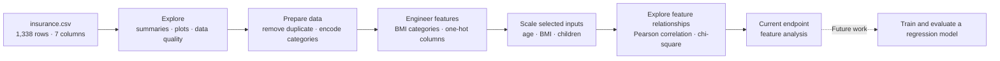

# Medical Insurance Cost Analysis

An exploratory data analysis (EDA) and preprocessing project using a medical insurance dataset. It examines how age, BMI, smoking status, family size, sex, and region relate to insurance charges.

> **Project status:** learning / exploratory analysis. This repository does not contain a trained or evaluated prediction model. The notebook currently ends during feature-selection analysis.

## Project at a glance

- **Rows:** 1,338 in the original CSV; the notebook removes one duplicate row during cleaning.
- **Features:** 6 input fields plus the continuous target, `charges`.
- **Notebook:** `medical_insurance_cost_analysis.ipynb`
- **Dataset:** `insurance.csv`
- **Methods explored:** summary statistics, missing/duplicate checks, visual EDA, categorical encoding, BMI categories, standardization, Pearson correlation, and chi-square tests over charge quartiles.

## Analysis flow



## Repository contents

| File | Description |
|---|---|
| `medical_insurance_cost_analysis.ipynb` | Notebook with the EDA, preprocessing steps, analysis notes, and saved chart outputs. |
| `insurance.csv` | Dataset used by the notebook. It stays at the repository root so the notebook's existing `pd.read_csv('insurance.csv')` cell works when launched from this directory. |
| `requirements.txt` | Python packages used by the notebook. |
| `.gitignore` | Python and Jupyter-generated files excluded from Git. |

## Run it locally

Use Python 3.10 or newer.

```bash
python -m venv .venv
```

Activate the environment, then install the dependencies and launch Jupyter:

```bash
python -m pip install -r requirements.txt
jupyter notebook medical_insurance_cost_analysis.ipynb
```

Run the notebook with the repository root as the working directory so it can find `insurance.csv`.

## What the notebook currently finds

- The source CSV has no missing values; duplicate removal leaves 1,337 rows.
- In the notebook's Pearson analysis, smoking status has the strongest listed linear association with charges (about **0.787**), followed by age (about **0.298**) and BMI (about **0.196**).
- These are exploratory associations, not causal conclusions or evidence of predictive performance.

## Current scope and limitations

- The work focuses on exploring and preparing the data; it does **not** train a regression model or report test-set performance.
- The notebook converts the entire cleaned dataframe to integers before scaling. This truncates decimal values, including BMI and the charge target, and should be reviewed before using the prepared data in a model.
- Statistical tests and feature selection here are exploratory. They do not replace validation on held-out data.
- The original dataset source and license were not documented in the files provided with this project. Verify and add the upstream dataset attribution and terms if you know the source.

## Dataset fields

| Field | Meaning |
|---|---|
| `age` | Age of the individual |
| `sex` | Recorded sex category |
| `bmi` | Body mass index |
| `children` | Number of children / dependents |
| `smoker` | Smoking status |
| `region` | Residential region category |
| `charges` | Medical insurance charges; continuous analysis target |

## Images and charts

