# 💳 Medical Insurance Cost Analysis

> **A visual, notebook-based exploration of what moves medical insurance charges.**

This project uses Python to explore a classic insurance dataset and prepare its features for analysis. Follow the charts from the first look at the data through cleaning, feature engineering, scaling, and statistical feature checks.


---

## ✨ Project snapshot

| | |
|---|---|
| **Question** | How do age, BMI, smoking status, family size, sex, and region relate to insurance charges? |
| **Data** | 1,338 rows · 7 columns |
| **Target** | `charges` — a continuous cost measure |
| **Tools** | Python · pandas · seaborn · Matplotlib · SciPy · scikit-learn |
| **Best place to start** | [Open the analysis notebook](medical_insurance_cost_analysis.ipynb) |

## 📊 Take a visual tour

The charts below are exported from the notebook’s saved outputs, so they’re easy to preview without running any code.

| Insurance charge distribution | Charges by smoking status |
|---|---|
| 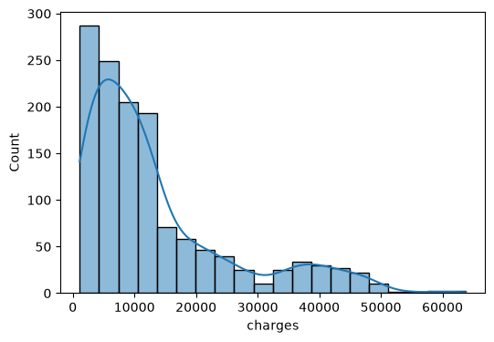 | 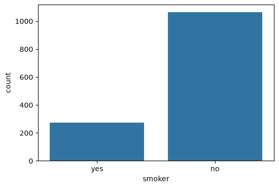 |

| Numeric feature correlations | Charge outliers and spread |
|---|---|
| 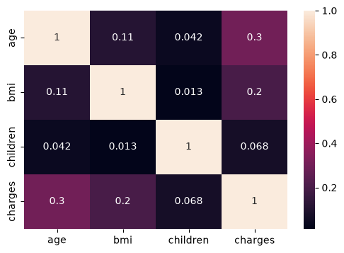 | 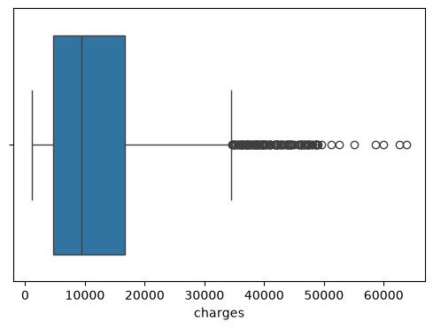 |

| BMI distribution before feature engineering | BMI distribution after duplicate removal |
|---|---|
| 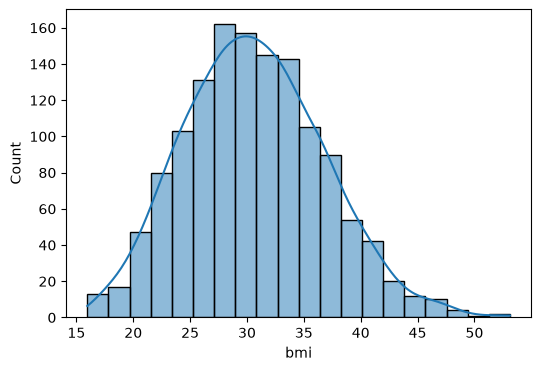 | 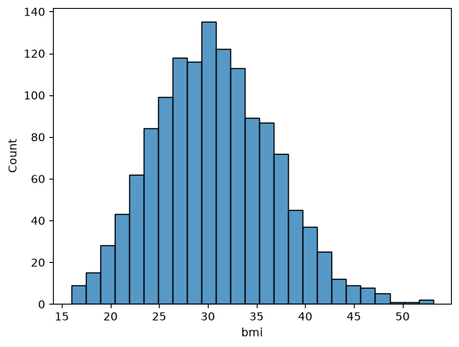 |

<details>
<summary><strong>See all saved notebook charts</strong></summary>

### Distributions

| Age | BMI | Children | Charges |
|---|---|---|---|
| 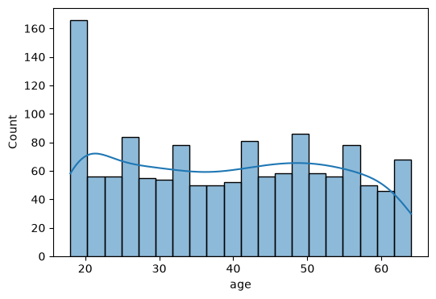 |  | 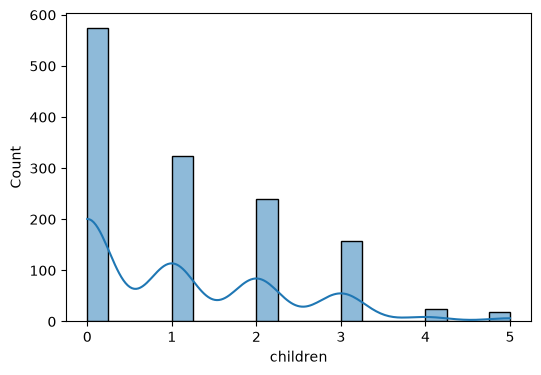 |  |

### Category counts

| Sex | Smoker | Children | Region |
|---|---|---|---|
| 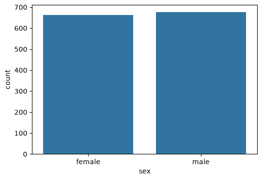 |  | 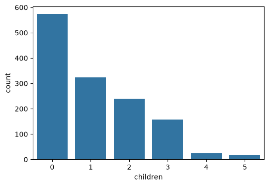 | 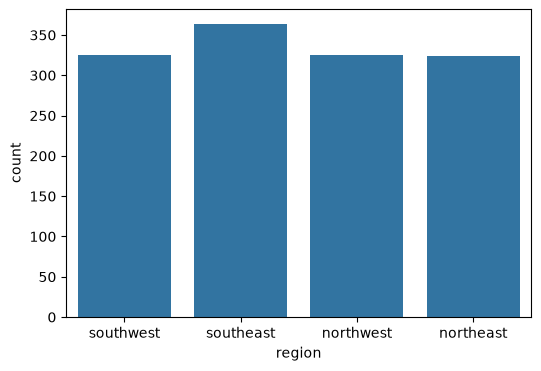 |

### Boxplots

| Age | BMI | Children | Charges |
|---|---|---|---|
| 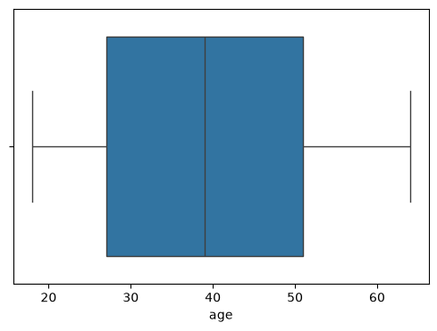 | 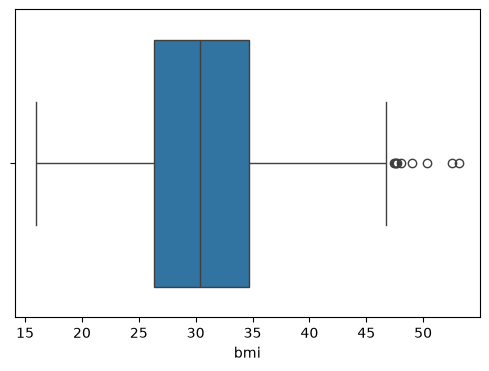 | 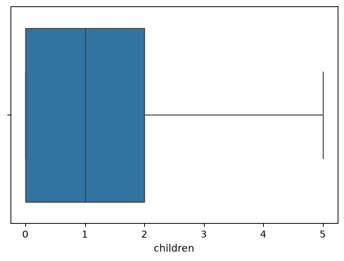 |  |

</details>

## 🧭 How the analysis flows


## 🔎 What stood out

- The source file contains **1,338 records** and has no missing values; the notebook removes one duplicate during cleaning.
- The charge histogram has a long right tail: most observations are lower, with fewer very high charges.
- In the notebook’s Pearson analysis, smoking status has the strongest listed association with charges (**r ≈ 0.787**), followed by age (**r ≈ 0.298**) and BMI (**r ≈ 0.198**).
- These are exploratory relationships in this dataset. They do not show that a feature causes higher charges.

## 🧪 What’s inside the notebook

The notebook walks through:

1. Dataset shape, types, summary statistics, and missing-value checks
2. Histograms, category counts, boxplots, and a numeric correlation heatmap
3. Duplicate removal and categorical encoding
4. BMI grouping and one-hot encoding
5. Standard scaling for selected numeric features
6. Pearson correlation and chi-square feature exploration

The project is an **EDA and feature-preparation study**. It focuses on understanding the data and does not present a trained prediction model or test-set score.

> **Preprocessing note:** Boolean one-hot columns are converted to 0/1 flags; continuous BMI and charge values retain their decimal precision.

## 🚀 Run it yourself

Clone or download this repository, then from its root:

```bash
python -m venv .venv
```

Activate the environment and install the packages:

```bash
python -m pip install -r requirements.txt
```

Launch the notebook:

```bash
jupyter notebook medical_insurance_cost_analysis.ipynb
```

The CSV is kept beside the notebook, so its existing `pd.read_csv("insurance.csv")` cell works when Jupyter starts from the repository root.

## 🗂️ Repository map

```text
.
├── images/                              # chart exports shown above
├── insurance.csv                        # analysis dataset
├── medical_insurance_cost_analysis.ipynb # full notebook and saved outputs
├── requirements.txt
└── README.md
```

## 📚 Dataset

The data matches the [Medical Cost Personal Datasets on Kaggle](https://www.kaggle.com/datasets/mirichoi0218/insurance). It contains age, sex, BMI, number of dependents, smoking status, region, and individual insurance charges.
